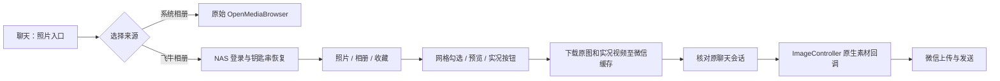

# 实现与边界

Objective-C / Logos internal；最低 iOS 15。插件仅匹配 `com.tencent.xin`，不依赖 MobileSubstrate / ElleKit 的动态链接符号。Dopamine 负责加载 rootless 包；免越狱签名工具负责将 dylib 加入 WeChat 主程序的加载命令。

## 微信边界

- Hook `ImageController -OpenMediaBrowser`；仅当其 `getViewController` 是聊天页、delegate 有 `processInsertedAsset:`、能取得会话标识时显示来源选择。
- `didSelectMMAsset:finish:fromImagePicker:` 是 8.0.76 已静态核对的原生完成路径，内部调用该 ImageController 当前 delegate 的 `processInsertedAsset:`。插件不构造消息或直接调用 CMessageMgr。
- 动态调用前检查参数个数、返回类型与参数类型；不硬编码函数地址。8.0.75 已在真机读取接口签名，8.0.76 来源于用户参考 IPA。
- 自有图片子类继承 `MMAssetForLocalImage`，补齐上传所需的原始数据和大图回调。大图的处理与完成回调均传 `(UIImage *, NSData *)`，先处理后完成；EXIF 使用独立回调。实况子类携带本地电影路径、时长和大小，保留原始配对资源；动态注册避免链接私有类符号。
- `setLivePhotoVideoSize:` 在真机 8.0.75 为 `q`，兼容 `q/Q` 两种 64 位签名。
- 使用 `FNImageDelivery` 显式复制并持有微信的处理与完成 Block，避免栈回调跨异步文件读取后失效。
- 所有选中素材准备成功后才提交；提交前检查聊天控制器、delegate、接收会话、NAS 账号。提交后禁用重试，避免重复发送。
- GIF 不转 JPEG。实况缺少视频或接口时停止，不能静默按封面发送。

## NAS 边界

移植桌面客户端协议，原生实现不嵌入 Python。HTTP 只允许当前 NAS 同源地址，禁止重定向；accessToken、Authorization、Cookie 和 authx 仅用于该源。WebSocket 登录使用 RSA PKCS#1 v1.5 封装 AES256 密钥，AES-CBC/PKCS7 加密登录数据；令牌恢复消息使用 HMAC-SHA256 前缀。

GET authx 对最终 URL 解码一次，按参数名排序并取第一个重复值，按桌面端测试向量计算 MD5。相册请求包含排序、偏移和数量；全部/收藏先取日时间线，再按实际返回条数维护游标。分页失败不提交游标。

Keychain 项目使用 `org.ac.WeChatFnAlbum.session`，保存 NAS 地址、账号、token、longToken 和 secret，不保存密码。暂时网络故障保留凭据。明确的失效响应或主动退出才删除；钥匙串失败会提示，不将令牌降级写入偏好文件。

## 文件与诊断

所有媒体存入微信 `Library/Caches/WeChatFnAlbum`，不调用系统相册写入接口。发送交接前写 `handoff.plist`；这些目录不会按时间删除，防止微信异步上传仍在使用。设置页可在确认微信完成发送后手动清理。未交接的旧缓存只在下次进程启动时清理。

`runtime.json` 仅记录微信版本、相关类和方法签名，不记录聊天内容、接收人、NAS 凭据。`FN_DEVICE_TESTS=1` 是开发专用编译标志，正式构建不包含素材自检代码。

## 日期导航与 AI 搜索（0.2.0）

`FNTimelineScrubber` 是照片列表右侧 48 点触摸区域，滑块和日期浮层由 UIKit 布局。浏览器在滚动和布局变化时将其固定到可见视口；普通滚动根据首张可见照片更新时间，拖动结束只提交一次跳转。新 `FNPhotoPager` 共享不可变日期索引，独立持有游标，不修改旧分页对象；相册跳转使用日期范围加 album_id，避免累计 offset 在 NAS 内容变化时指向错误日期。

搜索是 `FNPhotoPager.searchKeyword` 模式：先获取 AI 结果 ID，再按需补取详情，每次 60 个，成功后提交游标。批量响应可能乱序，客户端按 ID 恢复原搜索顺序。搜索模式隐藏日期条，因为相关度顺序不能映射到完整照片时间线；取消或清空搜索恢复原分类。搜索提交收起键盘，继续使用原浏览器的预览与发送入口。

POST 请求签名只对最终 HTTPBody 的字节计算一次，与发送内容保持一致；GET 继续使用原查询参数规范化算法。整个搜索只访问当前 NAS 来源，凭据、缩略图和发送素材仍受原同源与账号代际约束。

## 触摸与输入容器修正（0.2.1）

浏览器从 UICollectionViewController 改为 UIViewController 管理 UICollectionView，日期条与列表成为同级视图。日期条不再位于列表 pan 手势的祖先链内；内部装饰 track 禁用 userInteractionEnabled，避免装饰视图截获 UIControl 触摸。日期条仍只在松手后提交 NAS 日期跳转。

顶部使用直接嵌入页面的 UISearchBar，不再设置 navigationItem.searchController 或展示 UISearchController。它与列表同级，并在安全区域内独立布局；输入、取消、清空和提交通过 UISearchBarDelegate 处理，提交或发送前收起键盘。日期条 frame 使用列表在根视图中的 frame，滚动 contentOffset 不参与定位。

## 独立搜索输入（0.2.3）

搜索入口改为 UIButton，由当前浏览器展示 UIAlertController 内的 UITextField，在呈现 completion 中设置第一响应者。输入动作与照片列表生命周期分离，提交后沿用 FNPhotoPager.searchKeyword，取消不修改查询，独立清除按钮返回原分类。查询提交回调持有 UITextField，以便弹窗退出时仍能读取完整输入，避免通过弱弹窗引用读取已释放的输入内容。日期快滑逻辑不变。
## 签名多开宿主识别（0.2.4）

构造函数调用 FNIsWeChatMainApplication，以主 .app、APPL 包类型和 WeChat 可执行文件识别宿主，不再固定 CFBundleIdentifier；随后仍使用 FNBridgeAvailable 验证媒体接口。签名工具直接注入 dylib 不依赖 MobileSubstrate filter；越狱安装包的 filter 保持原微信包名范围，本次不扩大越狱加载器的进程过滤规则。

## Historical window cursors (0.2.5)

FNPhotoPager maintains independent head and tail cursors after a date seek. previous reads up to 60 rows immediately before the head, prepending each newer-day segment in descending date order. readDay shares album/favorites constraints and row validation in both directions. A cursor is committed only on complete success. FNBrowserController disables full refresh while browsingFromDate is active, fetches newer pages near the top, and restores the visible anchor after prepending. Category changes and explicit reload still open the latest range.

## 视频与分类（0.3.0）

FNCategoriesController 管理人物、地点和媒体类型目录。FNCategoryFilters 构建 person、photo_location 和 file_type 筛选树。FNPhotoPager.queryFilters 与 AI 搜索共用 ID 分页详情管线；筛选页隐藏完整时间线滑块。地点目录分页，人物目录排除隐藏人物。

视频网格只使用缩略图 URL，禁止回退到原视频。预览将原视频下载到专用缓存，检查 AVURLAsset.playable 后交给 AVPlayerViewController；切换或关闭预览时释放播放器并删除预览文件。发送准备独立交接缓存，沿用会话校验与缓存生命周期。

动态 ACFNLocalVideoAsset 继承 MMAssetForLocalVideo 的视频读取、封面和异步接口，覆盖 copyWithZone 保留本地路径。原生基类复制丢失路径已在真机复现。每次发送独立创建不可变素材，复制返回强持有的同一素材；调用前仍检查私有接口签名。

## 媒体服务读取与人物头像（0.3.1）

FNClient.download 将临时文件移动到私有缓存后显式设置 POSIX 0644。NSURLSession 默认的 0600 在实测 iPadOS 15.2 上阻止 AVFoundation 媒体服务读取；文件仍位于微信容器，已有文件保护与缓存清理规则不变。预览与发送报告具体读取错误，不把所有 playable=false 都解释为编码问题。

人物头像使用 APK 的 faceId 流接口，经现有同源签名客户端请求；缩图在后台解码至最多 160 像素，控制器缓存上限 6 MB。FNCategoryCell 取消复用请求并核对头像路径，避免滚动时人物头像错位。列表的头像区域固定为 64 点圆形，整行保持原筛选入口。

## 普通视频资源地址（0.3.2）

FNMediaURL(photo, YES) 对普通视频优先取 additional.thumbnail.videoUrl，再兼容 originalUrl；后者在实测 NAS 可为 JPEG 封面，不可一概当作视频。图片和实况的静态原图继续使用 originalUrl；实况配对视频已有独立路径。缩略图分支不使用 videoUrl，避免原视频进入网格图片缓存。

## 视频消息交接（0.3.3）

图片、GIF 和实况仍经 didSelectMMAsset:finish:fromImagePicker:。该入口对普通视频也会请求大图回调，不能当作通用视频入口使用。视频下载后以 AVAssetExportSession 生成最多 1080p 的兼容 MP4，并后台生成 JPEG 封面，构建 CaptureVideoInfo；在用户发送并完成会话校验后，调用当前聊天 delegate 的 CameraControllerDidTakeVideo:。所有视频文件和封面准备完成后才进入交接，取消时停止 export 与封面生成，失败不提交任何素材。

FNMediaHandoff 在任何回调前检查所有所需签名，将视频对象与图片素材分发到各自原生完成接口。混选时最后一张图片独立标记 finish，纯视频完成后关闭插件选图页。原图模式保留原始文件，通过 CaptureVideoInfo 的 bRawVideo、nsRawVidePath、rawFileLength 和 asset 提供原视频；普通 MP4 与原文件均遵守已交接缓存不自动删除的规则。

## 预览加载层（0.3.4）

FNPreviewLoadingView 负责遮罩、百分比和阶段显示，不拦截触摸。FNPreviewController 在主线程以 common modes 定时读取当前任务字节数，不更改 NAS 协议及发送逻辑；未知总大小仅显示活动指示器。下载结束后停止计时并显示解析状态，完成渲染或失败时隐藏遮罩。独立 loadingTicket 避免实况与静态封面并发时串进度，现有 generation 则隔离滑动后的素材响应；离开页面取消加载并释放计时器。

## 自动续期与逻辑下载（0.3.5）

FNHTTPOperation 为所有 HTTP 请求维护账号代际、一次重试预算和使用过的短令牌。首次 401 调用 recoverToken；同账号认证以 authenticating/authWaiters 合并，使用 authOperation 隔离被退出或新登录替代的结果。冷启动继续 authToken → 必要时 tokenLogin，运行中优先 tokenLogin。轮换结果继续保存至 Keychain，非明确认证失效不删除持久凭据。

FNTransfer 代表一个逻辑下载，转发当前底层任务的字节计数，取消会终止当前任务并完成一次；等待续期时取消也不会在续期后重新发起。401 临时文件不会移动到素材缓存，只有成功响应才落盘。重试保留原请求的 POST 数据及查询，重新计算 authx 与认证头；代际不匹配时禁止向旧 NAS 请求携带新账号凭据。

### 内外网访问

FNNetworkRouting 在新建浏览页时读取已配置路由；自动模式异步取得 SSID（3 秒截止），未知时静默走外网（0.3.8 起）；主动检查权限的结果仅在设置页显示。设置保存在宿主 NSUserDefaults，不含密码。用户配置的两个地址必须属于同一 NAS；FNClient.routeToAddress 先验证当前凭据源属于显式别名集合，再切换 generation 并重新认证。失败保留 Keychain，未记住会话时保留仅内存的路由快照供重试，退出清除。HTTP 媒体只在显式集合与活动地址之间重绑定 origin 并签名，维持第三方地址拒绝。定位与 Wi-Fi 权限由宿主签名/系统提供，插件不修改 entitlements。

## 原视频流式预览（0.4.3）

FNPreviewController 直接用 NAS 的 videoUrl 建立 AVURLAsset，AVPlayer 按 HTTP Range 拉取原视频，不调用 decode/info、decode/play、record 或 quit，也不做页面预热。FNNASVideoPreview 为旧版本实现，已从 Theos 正式编译列表移除。

FNClient.originalVideoPlaybackConfiguration 复用地址校验与可信别名规则，为精确媒体路径提供 host-only Cookie，不写入全局 Cookie 存储。AVPlayer 自行读取媒体头、尾部索引和当前播放分段；缓冲遮罩展示当前范围内实际可播放秒数，出现第一帧后消失。切换“原图”仅影响发送。失败后通过 photoDetails 触发既有鉴权续期并取回最新媒体地址，最多重试一次、尽量恢复播放位置；重试使用新 loading ticket，防止首播结束后的重连遮罩无法消失。用户取消或切素材时通过 generation 丢弃旧回调。

无法流式播放时明确提供“完整下载后预览”，不自动转码或静默下载完整文件。不能由 Range 探测成功推断所有编码/容器都受 iOS 支持。发送仍走完整文件准备与微信原生视频消息接口，不使用预览缓存代替发送素材。
